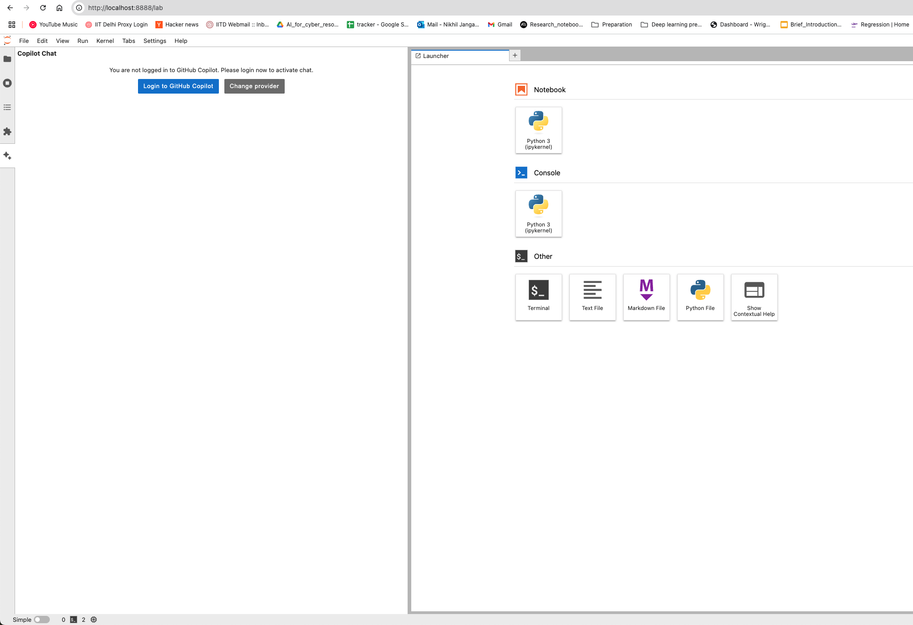
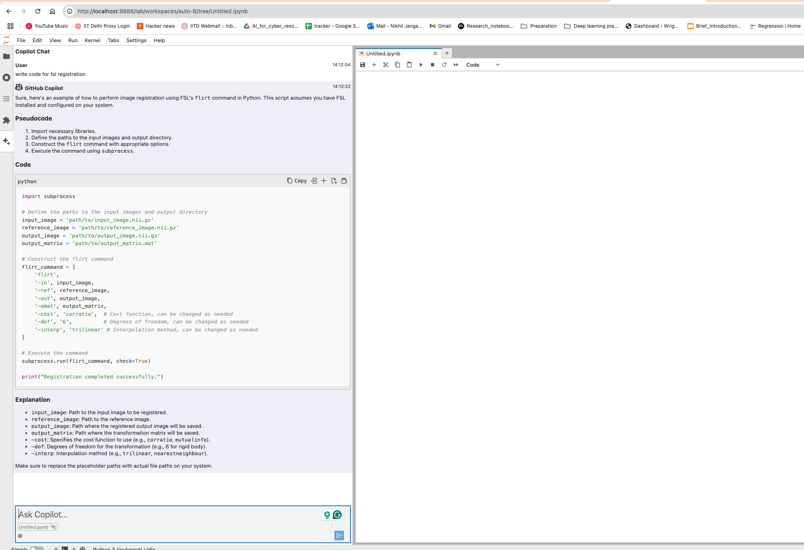
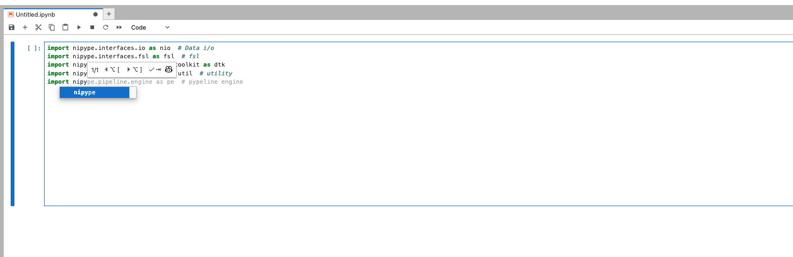
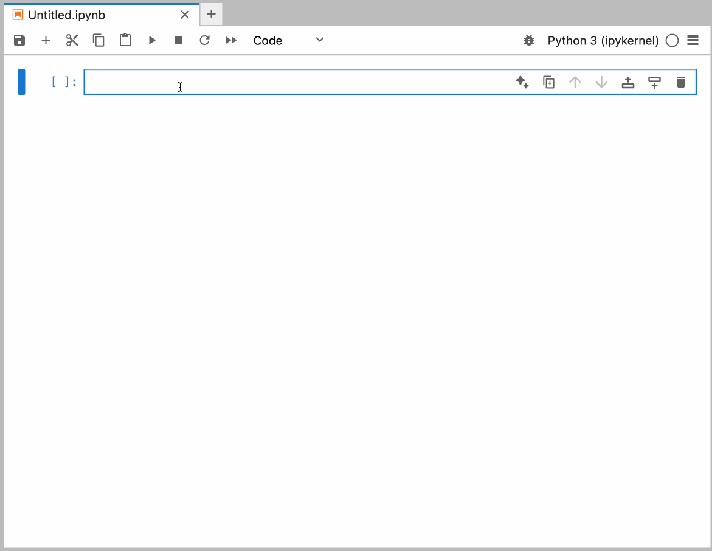

## Neurodesk Copilot: using GitHub Copilot inside the Neurodesk environment

This guide provides detailed instructions on how to set up and use GitHub Copilot in the Neurodesk environment, enabling code autocompletion, real-time chat assistance, and code generation.

### Step 1: log in with GitHub and follow the instructions below

1. Make sure you have a GitHub account with a valid GitHub Copilot subscription or access. If you are an eligible student, teacher, or open-source maintainer, you can access GitHub Copilot Pro for free. See [Getting free access to Copilot Pro as a student, teacher, or maintainer](https://docs.github.com/en/copilot/managing-copilot/managing-copilot-as-an-individual-subscriber/managing-your-github-copilot-pro-subscription/getting-free-access-to-copilot-pro-as-a-student-teacher-or-maintainer).
2. Log in to the Sciget App or Neurodesktop using the GitHub single sign-on (SSO) option.
3. Grant permission to GitHub Copilot when prompted to ensure Copilot can operate within your Neurodesk environment.

### Step 2: use the chat interface

1. Open the Chat feature in Neurodesk in the left-hand bottom of the list and type your query or command. Examples:
   - **"Explain how to apply a Fourier Transform in NumPy."**
   - **"Help me debug my data-loading function."**
2. Press Enter. Neurodesk Copilot will respond with explanations, tips, or suggested code.

### Step 3: code completion

1. Click on the Python `[conda env:base]` to open a new Python file.
2. Begin typing your code within a cell in Neurodesk. As you type, Copilot provides inline suggestions. You can accept suggestions by pressing the **Tab** key.
3. If the suggestion isn't relevant, continue typing or press **Escape** to dismiss it.

### Step 4: generate code

1. When you need a larger block of code or a specific function, ask Copilot directly in the chat or as an inline comment. For example:
   - **"Generate a Python function that reads EEG data from a CSV, cleans noise, and plots the channels."**
2. Copilot will produce a snippet of code you can accept, edit, or reject entirely.

### Configuring LLM provider and models

You can configure the model provider and model options using the Notebook Intelligence Settings dialog. You can access this dialog from the JupyterLab Settings menu, Notebook Intelligence Settings, using the `/settings` command in Copilot Chat, or by using the command palette.
