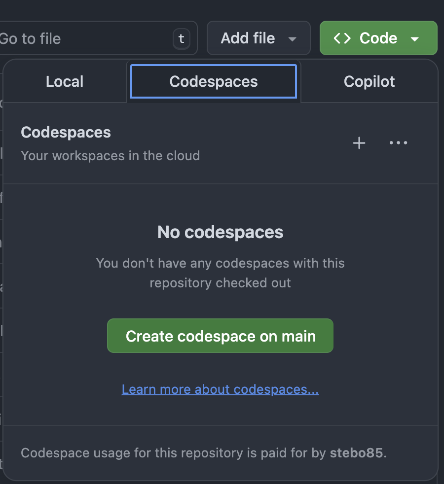
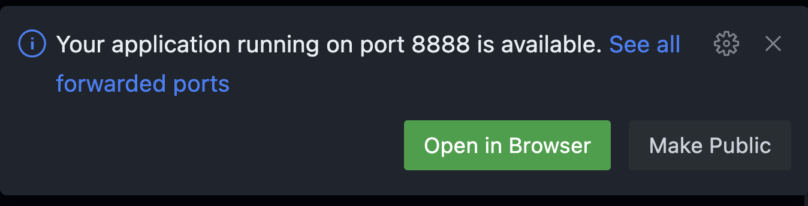

import { Code } from '@astrojs/starlight/components';
import { jupyterNeurodeskVersion } from '../../../../config/neurodesktop';

export const codespaceRunCommand = `docker volume create neurodesk-home &&
sudo docker run \\
  --shm-size=1gb -it --privileged --user=root --name neurodesktop \\
  -v ~/neurodesktop-storage:/neurodesktop-storage \\
  --mount source=neurodesk-home,target=/home/jovyan \\
  -e NB_UID="$(id -u)" -e NB_GID="$(id -g)" \\
  -p 8888:8888 \\
  -e NEURODESKTOP_VERSION=${jupyterNeurodeskVersion} \\
  ghcr.io/neurodesk/neurodesktop/neurodesktop:${jupyterNeurodeskVersion}`;

Start a GitHub Codespace in the repository of your choice:

Then start the neurodesktop container in a terminal:

<Code code={codespaceRunCommand} lang="bash" mark={jupyterNeurodeskVersion} />

Then open Neurodesktop in the browser by clicking the **Open in Browser** button displayed:

The token for authentication is displayed in the terminal. Look for the URL containing `?token=...`:

	

		

		

		

	

	

		<pre class="fake-log">{`[I 2025-04-10 01:49:14.301 ServerApp] Serving notebooks from local directory: /home/jovyan
[I 2025-04-10 01:49:14.301 ServerApp] Jupyter Server 2.15.0 is running at:
[I 2025-04-10 01:49:14.301 ServerApp] `}<mark class="fake-token">{`http://localhost:8888/lab?token=90b9a934f6a76e87e88a9718aada4c6520984694ff853cf2`}</mark>{`

    To access the server, open this file in a browser:
        file:///home/jovyan/.local/share/jupyter/runtime/jpserver-69-open.html
    Or copy and paste one of these URLs:
        `}<mark class="fake-token">{`http://localhost:8888/lab?token=90b9a934f6a76e87e88a9718aada4c6520984694ff853cf2`}</mark>{`
        `}<mark class="fake-token">{`http://127.0.0.1:8888/lab?token=90b9a934f6a76e87e88a9718aada4c6520984694ff853cf2`}</mark></pre>
	

