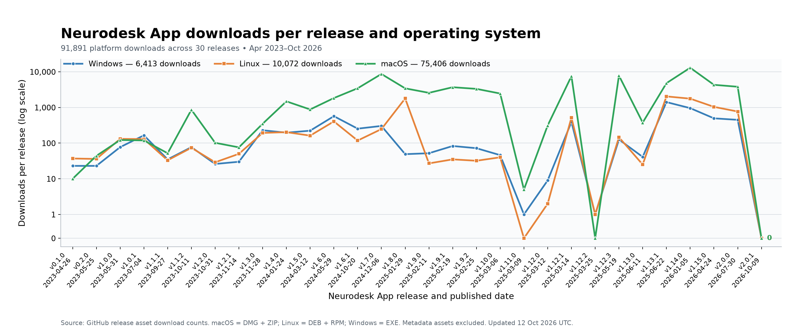

## User locations &mdash; past 30 days

This map shows where Neurodesk users were recorded during the past 30 days. It counts traffic on Neurodesk production sites only.

  Loading user statistics...

## Cumulative user metrics &mdash; all time

The chart and map show cumulative Neurodesk users since tracking began. The table below lists new and cumulative users by month.

  Loading user statistics...

## Neurodesk App download metrics

## Container usage &mdash; CVMFS

This dashboard shows how Neurodesk containers are used from the CVMFS repository `neurodesk.ardc.edu.au`, aggregated daily from all Stratum&nbsp;1 servers. Only privacy-preserving, k-anonymous statistics are used: no IP addresses or cities are stored.

### How to read the numbers

- **Container opens** count how often a computer or site cache that did *not* already have a container fetched it from a Stratum&nbsp;1 server. Running a tool again on the same computer, or on other computers behind the same institutional cache, is usually not counted. One open can therefore stand for many runs: opens show how widely a tool is pulled, not how often it is run or by how many people.
- Using files or binaries inside a container that is already loaded does not add opens. Those downloads appear only in **data served** and **requests**, and only when they are not already cached.
- Machines that start with an empty cache every time (CI runners, cloud VMs) count each time they load a container and can cause spikes. Use the numbers to compare tools and trends, not as counts of users or runs.

{/* Loaded without defer on purpose: the listener must exist before the iframe posts its first height. */}

  <iframe
    id="cvmfs-dashboard"
    class="cvmfs-dashboard-frame"
    src="https://neurodesk.github.io/cvmfs-infrastructure/?embed=1"
    title="Neurodesk CVMFS usage dashboard"
    loading="lazy">
  </iframe>

Full dashboard: [neurodesk.github.io/cvmfs-infrastructure](https://neurodesk.github.io/cvmfs-infrastructure/)

## Repository metrics

  <a class="repo-card" href="https://hub.docker.com/r/vnmd/neurodesktop">
    <h3>Docker · vnmd/neurodesktop</h3>
    

      
    

  </a>
  <a class="repo-card" href="https://github.com/neurodesk/neurodesktop">
    <h3>neurodesktop</h3>
    

      
      
      
    

  </a>
  <a class="repo-card" href="https://github.com/neurodesk/neurocommand">
    <h3>neurocommand</h3>
    

      
      
      
    

  </a>
  <a class="repo-card" href="https://github.com/neurodesk/neurocontainers">
    <h3>neurocontainers</h3>
    

      
      
      
    

  </a>
  <a class="repo-card" href="https://github.com/neurodesk/transparent-singularity">
    <h3>transparent-singularity</h3>
    

      
      
      
    

  </a>
  <a class="repo-card" href="https://github.com/neurodesk/neurodeskedu">
    <h3>neurodeskEDU</h3>
    

      
      
      
    

  </a>
  <a class="repo-card" href="https://github.com/neurodesk/neurodesk.github.io">
    <h3>neurodesk.github.io</h3>
    

      
      
      
    

  </a>
  <a class="repo-card" href="https://github.com/neurodesk/neurodesk-app">
    <h3>neurodesk-app</h3>
    

      
      
      
      
    

  </a>

## NeurodeskEDU usage

  
These statistics are generated from Google Analytics 4 for the NeurodeskEDU path.

  Loading service usage statistics...

## Play usage

  
These statistics are generated from Google Analytics 4 and reported separately for each tracked Play server.

  Loading service usage statistics...

## Webapp usage metrics

  
These statistics are generated from Google Analytics 4 for each hosted Neurodesk webapp.

  Loading service usage statistics...

## Uptime metrics

  Loading uptime metrics...

Live status page: [stats.uptimerobot.com/NBE38IZWZM](https://stats.uptimerobot.com/NBE38IZWZM)
